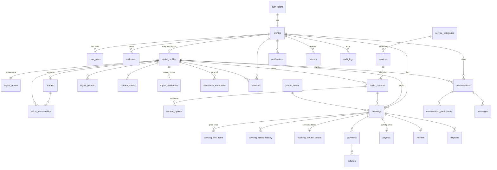

# Database guide

PostgreSQL (through Supabase). Everything is defined in `supabase/migrations/`, applied in filename order:

| File | Contents |
|---|---|
| `…0001_schema.sql` | Extensions, enum types, every table, constraints and indexes |
| `…0002_helpers_and_triggers.sql` | Default platform settings, permission helper functions, signup handling, column-protection triggers, rating aggregation, audit triggers, review eligibility, listing requirements |
| `…0003_row_level_security.sql` | RLS turned on for every table, plus all policies |
| `…0004_pricing_availability_bookings.sql` | `quote_booking`, `get_available_slots`, `create_booking`, `transition_booking`, `cancel_booking`, `reschedule_booking`, refunds queue |
| `…0005_payments.sql` | Payment preparation, Stripe result recording (`svc_*`), payouts, e-Transfer and pay-in-person |
| `…0006_social_admin_search.sql` | Notifications, reminders, messaging, reviews, disputes, admin functions, `search_stylists`, `public_profiles` view |
| `…0007_storage_realtime_permissions.sql` | Storage buckets and policies, Realtime publication, function EXECUTE grants |

Conventions: UUID primary keys, `timestamptz` (stored in UTC, shown in the viewer's time zone), money in **integer cents**, `created_at`/`updated_at` on every main table.

## Relationship diagram



`platform_settings`, `stripe_events` and `rate_limit_events` stand alone.

## Tables

| Table | Purpose | Who can read | Who can write |
|---|---|---|---|
| `profiles` | Name, phone, preferences, account status | Self, admins, people you have a booking/conversation with | Self (not status/email), admins |
| `user_roles` | client / stylist / admin | Self, admins | Signup trigger, `become_stylist()`, `admin_set_role()` only |
| `addresses` | Saved client addresses | Owner only | Owner |
| `platform_settings` | Commission, fees, policies, toggles | Public keys: everyone; all: admins | `admin_update_setting()` (validated) |
| `service_categories`, `services` | Shared hairstyle catalogue | Everyone (active rows) | Admins |
| `salons`, `salon_memberships` | Salon businesses and who works there | Everyone | Stylists (create/join), salon owners, admins |
| `stylist_profiles` | Public stylist profile, approx. location, booking rules, rating | Everyone when published | The stylist (not rating/approval/featured/verified), admins |
| `stylist_private` | Exact studio address, Stripe account | The stylist, admins | The stylist (not Stripe fields), server |
| `stylist_services`, `service_options` | What a stylist sells, prices, options | Everyone when active | The stylist |
| `stylist_portfolio`, `service_areas`, `stylist_availability` | Photos, travel areas, weekly hours | Everyone when published | The stylist |
| `availability_exceptions` | Time off | The stylist, admins | The stylist |
| `favorites` | Saved stylists | Owner | Owner |
| `promo_codes` | Discount codes | Admins (validated inside `quote_booking`) | Admins |
| `bookings` | Appointments with frozen prices | Client, stylist, admins | **Functions only** |
| `booking_line_items` | Itemised price at booking time | Parties, admins | Functions only |
| `booking_status_history` | Every status change | Parties, admins | Functions only |
| `booking_private_details` | Service address snapshot | Client; stylist once confirmed; admins | Functions only |
| `payments`, `refunds`, `payouts` | Money records | Parties (payouts: stylist), admins | Functions / service role only |
| `stripe_events` | Webhook log for idempotency | Nobody via API | Service role |
| `reviews` | One per completed booking | Everyone (unless hidden) | Eligible client; stylist reply via function; admins moderate |
| `conversations`, `conversation_participants`, `messages` | In-app chat | Participants | Messages: participants; conversations via function |
| `notifications` | In-app notices + email/SMS queue | Owner | Owner may mark read/delete; created by triggers |
| `reports` | Support requests and reports | Reporter, admins | Reporter creates; admins respond |
| `disputes` | Booking disputes | Booking parties, admins | Functions only |
| `audit_logs` | Who changed what | Admins | Triggers and admin functions only |
| `rate_limit_events` | Anti-spam counters | Nobody via API | Functions |

## Key functions

| Function | Called by | Does |
|---|---|---|
| `quote_booking(service, options, location, lat, lng, promo)` | Anyone | Authoritative price breakdown |
| `get_available_slots(service, date, options, exclude_booking)` | Anyone | Free start times for a day |
| `create_booking(...)` | Signed-in client | Validates everything, prices, inserts atomically |
| `transition_booking(id, status, reason)` | Stylist / admin | Accept, decline, start, complete, no-show |
| `cancellation_preview(id)` / `cancel_booking(id, reason)` | Parties / admin | Refund and late-fee rules |
| `reschedule_booking(id, new_start)` | Parties / admin | Move to another free slot |
| `prepare_payment(id)` | Booking's client | Decides amount due; creates/reuses a payment record |
| `svc_record_payment_succeeded/failed`, `svc_record_refund`, `svc_claim_payouts`, … | Service role only | Applied after Stripe responds; idempotent |
| `search_stylists(...)` | Anyone | Filtered, sorted discovery with distance |
| `admin_*` | Admins | Status, roles, verification, settings, disputes, e-Transfers… (audited) |

## Booking statuses

```
            ┌──────────── payment received ─────────────┐
create ──► pending_payment ──(15 min, unpaid)──► expired │
   │                                                     ▼
   ├──(instant)────────────────────────────────────► confirmed ──► in_progress ──► completed
   └──(approval)──► requested ──(stylist accepts)──────┘   │
                        │                                   └──(15 min after start)──► no_show
                        └──(stylist declines)──► declined
pending_payment / requested / confirmed ──► cancelled_by_client | cancelled_by_stylist | cancelled_by_admin
```

## Double-booking prevention

`bookings.time_range` is `[starts_at, ends_at + stylist buffer)`. The constraint

```sql
exclude using gist (stylist_id with =, time_range with &&)
  where (status in ('pending_payment','requested','confirmed','in_progress'))
```

makes PostgreSQL reject any overlapping active booking, even when two transactions race. `create_booking` also checks the slot is free first so the person gets a friendly message.

## Location and distance

Stylists' public coordinates are rounded to 2 decimals (~1 km) by a trigger. Distances use the haversine formula in `distance_km()`; an index on `(approx_lat, approx_lng)` supports the search. This is accurate enough for city-scale search. **Upgrade path:** enable PostGIS (`create extension postgis`), add a `geography(Point)` column with a GiST index and replace `distance_km()` with `ST_DWithin`/`ST_Distance` in `search_stylists` and `quote_booking`.

## Making changes

1. `npx supabase migration new describe_change` creates a new file in `supabase/migrations/`.
2. Write SQL. New tables: enable RLS and add policies in the same migration. New functions: `security definer` only when needed, always `set search_path = ''`, and add explicit `grant execute` / `revoke` (Supabase grants EXECUTE to everyone by default for new functions).
3. `npx supabase db reset` locally, then `npm run test:db`.
4. `npx supabase db push` to staging, test, then production.
